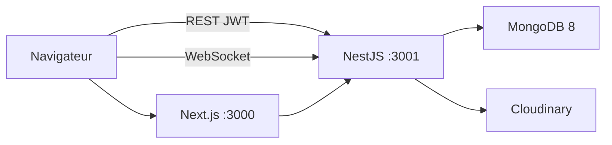

# TicketManager

Plateforme de **gestion d’incidents IT** (helpdesk) : tickets, rôles, notifications temps réel, puis industrialisation cloud (IaC, CI/CD, Kubernetes, observabilité).

Projet de fin d’études — cycle ingénieur. Stack : **NestJS · Next.js · MongoDB · Kubernetes · Terraform · Azure DevOps**.

[](.github/workflows/ci.yml)
[](backend)
[](frontend)
[](https://www.mongodb.com/)
[](k8s)
[](LICENSE)

---

## Fonctionnalités

| Rôle | Capacités |
|------|-----------|
| **Client** | Créer / consulter / filtrer ses tickets, pièces jointes (Cloudinary), modifier un ticket encore *ouvert* |
| **Technicien** | Traiter uniquement les tickets **assignés**, changer le statut (sauf clôture) |
| **Administrateur** | CRUD utilisateurs, tous les tickets, assignation, clôture, statistiques |

En plus du cycle de vie `ouvert → en cours → résolu → clôturé` :

- authentification **JWT** + **RBAC** à 3 rôles
- **historique d’audit** sur chaque ticket
- notifications **persistantes** + **WebSocket** (Socket.IO)
- pagination, filtres, recherche
- documentation API **Swagger** (hors production)
- seed de démonstration

---

## Architecture



En lab / cloud privé (Azure Stack Hub) :

```
Internet / VPN
        │
   ┌────▼────┐     VNet 10.1.0.0/16
   │ Ingress │     snet-mgmt 10.1.1.0/24  → VM-gestion (Nexus, pipeline, Prometheus/Grafana)
   │  NGINX  │     snet-db   10.1.2.0/24  → VM-DB (legacy, optionnelle)
   └────┬────┘     snet-aks  10.1.3.0/24  → workers Kubernetes
        │
   namespace ticketmanager
   frontend · backend · mongodb (StatefulSet)
```

| Couche | Technologie |
|--------|-------------|
| Frontend | Next.js 16, React 19, Tailwind CSS 4, Chart.js |
| Backend | NestJS 11, Passport JWT, Mongoose, Socket.IO, class-validator |
| Données | MongoDB 8, Cloudinary (pièces jointes) |
| Local | Docker Compose |
| Cloud | Terraform (`azurestack`), AKS Engine, Ansible |
| CI/CD | GitHub Actions + Azure Pipelines (SonarQube, Snyk, Trivy, Nexus) |

---

## Démarrage rapide (local)

Prérequis : **Node.js 22+**, **Docker**.

```bash
git clone https://github.com/VOTRE_COMPTE/TicketManager.git
cd TicketManager

# 1. MongoDB
docker compose up -d mongodb

# 2. Backend
cd backend
cp .env.example .env          # renseigner Cloudinary si vous testez les pièces jointes
npm ci
npm run seed
npm run start:dev             # http://localhost:3001  — Swagger : /api

# 3. Frontend (autre terminal)
cd frontend
cp .env.example .env
npm ci
npm run dev                   # http://localhost:3000
```

Tout le stack en conteneurs :

```bash
docker compose up -d --build
```

Le navigateur appelle l’API via `http://localhost:3001` (pas le hostname Docker interne).

### Comptes de démonstration

Uniquement pour le **développement local** (`npm run seed`). Changez-les avant tout déploiement.

| Email | Mot de passe | Rôle |
|-------|--------------|------|
| `admin@rfc.com` | `Admin123!` | admin |
| `tech1@rfc.com` | `Tech123!` | technicien |
| `client1@rfc.com` | `Client123!` | client |

---

## Structure du dépôt

```
├── backend/              API NestJS (auth, users, tickets, notifications)
├── frontend/             Application Next.js (espaces client / technicien / admin)
├── terraform/            IaC Azure Stack Hub (VNet, NSG, VMs)
├── k8s/                  Manifests Kubernetes + scripts de déploiement
├── ansible/              MongoDB (legacy) + Prometheus / Grafana
├── docs/                 Mémoire : sprints, UML, LaTeX
├── azure-pipelines.yml   CI/CD Azure DevOps (build → qualité → sécurité → Nexus → K8s)
└── docker-compose.yml    MongoDB + backend + frontend en local
```

---

## API (aperçu)

Swagger : `http://localhost:3001/api` (désactivé si `NODE_ENV=production`).

| Méthode | Endpoint | Accès |
|---------|----------|--------|
| `POST` | `/auth/login` | public |
| `GET` | `/auth/me` | authentifié |
| `GET/POST/PATCH/DELETE` | `/users/*` | admin |
| `GET/POST/PATCH/DELETE` | `/tickets/*` | selon le rôle |
| `POST` | `/tickets/attachments/upload` | authentifié |
| `GET/PATCH` | `/notifications/*` | authentifié |

Règles métier notables : un technicien ne modifie **que** le statut d’un ticket **qui lui est assigné** ; **seul l’admin** clôture.

---

## Tests

```bash
# Backend — unitaires
cd backend && npm test

# Backend — couverture / intégration / e2e
npm run test:cov
npm run test:int
npm run test:e2e

# Frontend — Vitest
cd frontend && npm run test:run

# Frontend — Playwright (app déjà lancée)
npm run e2e
```

CI GitHub Actions : lint, tests et build backend + frontend à chaque push / PR sur `main` et `develop`.

---

## Déploiement

### Docker Compose

Voir [Démarrage rapide](#démarrage-rapide-local). Fichiers d’exemple : `backend/.env.example`, `frontend/.env.example`.

### Kubernetes

Manifests dans [`k8s/`](k8s/README.md) : namespace `ticketmanager`, backend, frontend, MongoDB StatefulSet, Ingress NGINX + TLS.

Variables à fournir **hors Git** (Library Azure DevOps ou secrets Kubernetes) :

- `K8S_WORKER_PUBLIC_IP` — IP publique du worker
- `JWT_SECRET`, `NEXUS_USER`, `NEXUS_PASSWORD`
- `TF_RESOURCE_GROUP` — groupe de ressources Terraform
- credentials Cloudinary

Ne commitez jamais `k8s/backend-secret.yaml` ni `k8s/nexus-pull-secret.yaml` (modèles `*.yaml.example` uniquement).

### Terraform

```bash
cd terraform
cp terraform.tfvars.example terraform.tfvars   # secrets : hors dépôt
terraform init
terraform validate
terraform plan
```

Le state Terraform **ne doit pas** être versionné (`.gitignore` + backend distant recommandé).

### Pipeline Azure DevOps

`azure-pipelines.yml` : Build → Tests + couverture → SonarQube → Snyk → Docker → Trivy → Nexus → Terraform (gate manuelle) → Deploy K8s (gate) → Ansible monitoring.

Les IPs publiques et secrets se configurent dans la **Library** Azure DevOps, pas dans le YAML commité.

---

## Sécurité (publication GitHub)

Avant de rendre le dépôt **public** :

1. Vérifier qu’aucun `.env`, `terraform.tfstate*`, kubeconfig ou clé privée n’est suivi par Git.
2. Surcharger `K8S_WORKER_PUBLIC_IP`, `JWT_SECRET` et les mots de passe **en dehors** du code.
3. Les comptes `seed` sont des identifiants de lab : à désactiver / changer en production.
4. Le JWT est stocké dans `localStorage` (choix lab). En production : cookies `HttpOnly` + CSRF, rate limiting login, replica set MongoDB, TLS d’autorité reconnue.

Signaler une faille : ouvrez une issue **privée** ou contactez le mainteneur ; n’ouvrez pas d’issue publique avec un exploit.

---

## Documentation PFE

- Release 1 (socle applicatif) : [`docs/release-1/sprint-1.md`](docs/release-1/sprint-1.md)
- Release 2 (industrialisation) : [`docs/release-2/README.md`](docs/release-2/README.md)
- Diagrammes UML / architecture : [`docs/diagrammes/`](docs/diagrammes/)

---

## Licence

[MIT](LICENSE)
