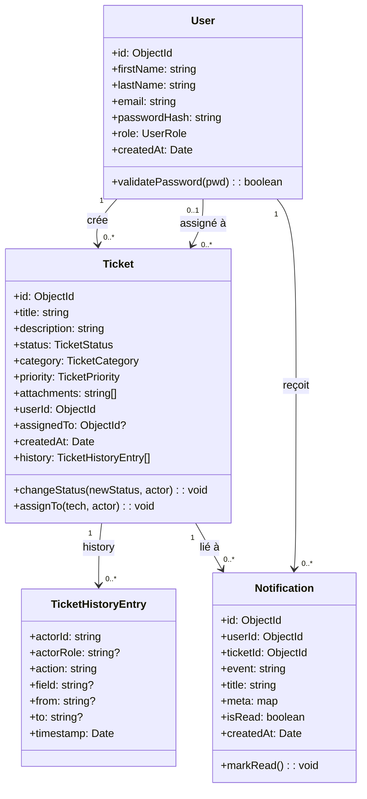

# TicketManager — Analyse globale (Besoins, UC, Classes)

> Document unique (Markdown) regroupant **besoins fonctionnels**, **besoins non fonctionnels**, **acteurs**, **cas d’utilisation**, et **diagrammes** (UC + classes) pour le projet TicketManager (NestJS + Next.js + MongoDB + Socket.IO + Cloudinary).

## 1) Contexte et objectifs

TicketManager est une application de gestion de tickets (support / helpdesk) avec 3 rôles :
- **Administrateur** : supervise, assigne, pilote l’activité.
- **Technicien** : traite les tickets qui lui sont assignés et met à jour les statuts.
- **Client** : crée des tickets, suit leur progression, reçoit des notifications.

Le système propose :
- Authentification JWT (24h), routes protégées, redirection `/login` si token expiré.
- Tickets avec pièces jointes (Cloudinary), historique des changements, filtrage + recherche + pagination.
- Notifications **persistantes** (cloche) + temps réel (Socket.IO) avec stratégie de réconciliation (polling / visibility refresh).

## 2) Portée (scope)

### 2.1 Inclus
- Gestion des utilisateurs (admin, technicien, client) : création (admin), consultation, authentification.
- Gestion des tickets : création, consultation, mise à jour (statut, affectation), historique.
- Filtrage, recherche, pagination sur les listes de tickets.
- Tableau de bord (stats) selon le rôle.
- Notifications : persistantes (MongoDB) + temps réel (Socket.IO).
- Upload et consultation/téléchargement de pièces jointes via Cloudinary.

### 2.2 Exclu (hors scope / à envisager)
- SLA, escalade automatique, règles métiers avancées (priorité auto, catégorisation ML).
- Commentaires/fil de discussion ticket (hors historique “champs modifiés”).
- Multi-tenancy (plusieurs organisations).
- Mode offline complet.

## 3) Acteurs (identification)

### 3.1 Acteurs principaux
- **Client**
  - Crée un ticket
  - Consulte ses tickets
  - Reçoit des notifications (affectation / changement statut)
- **Technicien**
  - Consulte ses tickets assignés
  - Change le statut (open → in_progress → resolved)
  - Reçoit une notification quand un ticket lui est affecté
- **Administrateur**
  - Crée des utilisateurs
  - Consulte tous les tickets
  - Affecte un ticket à un technicien
  - Consulte des statistiques
  - Reçoit des notifications (nouveau ticket client / statut modifié par technicien)

### 3.2 Acteurs secondaires / systèmes externes
- **Cloudinary** (système externe) : stockage et distribution des fichiers.
- **MongoDB** (SGBD) : persistance tickets, users, notifications.
- **Socket.IO** (bus temps réel) : diffusion d’événements.

## 4) Besoins fonctionnels (détaillés)

> Notation : **BF-x** = besoin fonctionnel.

### 4.1 Authentification / session
- **BF-01 Connexion**
  - L’utilisateur saisit email + mot de passe.
  - Le backend retourne un **JWT valide 24h**.
  - Le frontend stocke `access_token` et le rôle utilisateur (ex: `user_role`).
- **BF-02 Déconnexion**
  - L’utilisateur peut se déconnecter.
  - Le frontend supprime le token et redirige vers `/login`.
- **BF-03 Expiration JWT / redirection**
  - Si une requête API ou socket échoue par token expiré/invalide, l’utilisateur est redirigé vers `/login`.

### 4.2 Gestion des utilisateurs (Admin)
- **BF-10 Créer un utilisateur**
  - Admin crée un compte (client/technicien/admin) via formulaire.
  - Après succès : message “Utilisateur ajouté avec succès” + redirection/retour au dashboard admin.
- **BF-11 Lister / filtrer utilisateurs** *(si présent dans l’app)*
  - Admin consulte la liste, filtre par rôle, etc.
- **BF-12 Contraintes suppression technicien** *(si implémenté côté backend)*
  - Interdire suppression d’un technicien ayant des tickets assignés (retour 403 avec message métier).

### 4.3 Gestion des tickets
- **BF-20 Créer un ticket (Client)**
  - Champs : titre, description, catégorie, priorité, pièces jointes (optionnel).
  - Après création :
    - Ticket enregistré
    - Historique : “created”
    - Notification admin (persistante + temps réel)
    - **Le client n’est pas notifié** de sa propre création
- **BF-21 Consulter un ticket**
  - Client voit le détail de ses tickets.
  - Admin voit tous les tickets.
  - Technicien voit ses tickets assignés.
- **BF-22 Mettre à jour un ticket (Technicien)**
  - Technicien modifie le **statut** sur ses tickets assignés.
  - Historique : “status_changed” avec ancien → nouveau, timestamp, acteur.
  - Notifications :
    - Admin notifié (persistant + temps réel)
    - Client du ticket notifié (persistant)
    - Pas de toast “🔔 …” côté UI (tout passe par la cloche)
- **BF-23 Affecter un ticket (Admin)**
  - Admin assigne / désassigne un technicien.
  - Historique : “assigned_changed”.
  - Notifications :
    - **Technicien assigné** notifié (persistant + temps réel)
    - Client notifié (persistant) : “Technicien affecté …” / “Affectation retirée”
    - Admin **non notifié** de sa propre action d’affectation
- **BF-24 Pièces jointes**
  - L’utilisateur peut “Voir” (ouvrir) une pièce jointe et “Télécharger” (force download).
  - Les URLs doivent être correctes (Cloudinary) pour éviter “Page introuvable”.
- **BF-25 Historique visible**
  - Le détail ticket affiche l’historique, en français :
    - “admin a changé statut: …”
    - “technician a changé statut: …”
    - etc.

### 4.4 Listes, recherche, filtres, pagination
- **BF-30 Filtrer tickets (tous rôles)**
  - Par **statut**, **priorité**, **catégorie**, **date de création** (Du/Au).
- **BF-31 Recherche**
  - Recherche texte sur titre/description.
- **BF-32 Pagination**
  - Pagination visible : page actuelle, total pages, total éléments, précédent/suivant.
- **BF-33 Alignement UX**
  - Sections filtres alignées (admin/technicien/client).
  - Inputs sans labels visibles : placeholders uniquement (selon pages demandées).

### 4.5 Dashboards (stats)
- **BF-40 Dashboard Admin**
  - Statistiques tickets (par statut, par priorité, etc.) avec graphiques (Chart.js).
- **BF-41 Dashboard Technicien**
  - Statistiques des tickets assignés (par statut).
  - Liste des tickets assignés dans une page dédiée `/technician/tickets`.
- **BF-42 Dashboard Client**
  - Statistiques des tickets du client.
  - Sidebar avec “Dashboard”, “Mes Tickets”, “Nouveau Ticket”.

### 4.6 Notifications (persistantes + temps réel)
- **BF-50 Cloche (persistant)**
  - Affiche compteur non-lu, liste paginée, “Tout lu”.
  - “Marquer comme lu” au clic.
- **BF-51 Temps réel (Socket.IO)**
  - Événements principaux : `ticket.created`, `ticket.assigned`, `ticket.status_changed`.
  - Diffusion ciblée (rooms par rôle / user).
- **BF-52 Stratégie de réconciliation**
  - Polling périodique + refetch à la visibilité (si WebSocket a raté un event).

## 5) Besoins non fonctionnels (détaillés)

> Notation : **BNF-x** = besoin non fonctionnel.

### 5.1 Sécurité
- **BNF-01 JWT 24h** : expiration contrôlée, redirection `/login` si invalide.
- **BNF-02 Autorisations** : RBAC (Admin/Technicien/Client).
- **BNF-03 Contrôle d’accès tickets**
  - Client : uniquement ses tickets
  - Technicien : uniquement tickets assignés
  - Admin : tous
- **BNF-04 CORS / sécurité API** : config adaptée (front ↔ back).

### 5.2 Performance
- **BNF-10 Pagination** pour éviter de charger tout.
- **BNF-11 Index MongoDB**
  - `notifications`: `{ userId, createdAt }`, `{ userId, isRead, createdAt }`
  - `users`: `{ role }`
- **BNF-12 Endpoints optimisés**
  - `GET /notifications/unread-count` dédié (évite list+count + payload).

### 5.3 Fiabilité (MongoDB standalone)
- **BNF-20 Pas de transactions multi-doc** si MongoDB non Replica Set.
  - Stratégie : préférer opérations idempotentes, reconciliation côté front.

### 5.4 UX/UI
- **BNF-30 Cohérence UI**
  - Hauteurs d’inputs uniformes, dropdowns harmonisés, icônes alignées.
- **BNF-31 Accessibilité**
  - Boutons avec `aria-label` (ex: cloche).
  - Contrastes lisibles, focus visibles.

### 5.5 Maintenabilité / qualité
- **BNF-40 TypeScript + ESLint**
  - `npm run lint` doit passer (CI).
- **BNF-41 Structure claire**
  - Composants UI réutilisables (`Select`, `SearchInput`, `DateInput`).
- **BNF-42 CI**
  - Build + lint sur PR/push (GitHub Actions).

## 6) Cas d’utilisation (Use Cases)

### 6.1 Liste des UC (par acteur)

#### Client
- **UC-C1** S’authentifier
- **UC-C2** Créer un ticket (avec pièces jointes)
- **UC-C3** Lister / filtrer / rechercher ses tickets
- **UC-C4** Consulter le détail d’un ticket
- **UC-C5** Consulter notifications (cloche), marquer comme lu / tout lu

#### Technicien
- **UC-T1** S’authentifier
- **UC-T2** Lister / filtrer / rechercher tickets assignés
- **UC-T3** Modifier statut d’un ticket assigné
- **UC-T4** Consulter notifications (ticket affecté / statut modifié)

#### Administrateur
- **UC-A1** S’authentifier
- **UC-A2** Créer un utilisateur (client/technicien/admin)
- **UC-A3** Lister / filtrer / rechercher tous les tickets
- **UC-A4** Affecter un ticket à un technicien
- **UC-A5** Consulter stats dashboard
- **UC-A6** Consulter notifications (nouveau ticket client / statut modifié par technicien)

### 6.2 Diagramme de cas d’utilisation (Mermaid)

```mermaid
flowchart LR
  Client((Client))
  Tech((Technicien))
  Admin((Administrateur))
  Sys[TicketManager]

  Client -->|UC-C1 Connexion| Sys
  Client -->|UC-C2 Créer ticket| Sys
  Client -->|UC-C3 Lister/filtrer/rechercher| Sys
  Client -->|UC-C4 Détail ticket| Sys
  Client -->|UC-C5 Notifications (cloche)| Sys

  Tech -->|UC-T1 Connexion| Sys
  Tech -->|UC-T2 Tickets assignés| Sys
  Tech -->|UC-T3 Changer statut| Sys
  Tech -->|UC-T4 Notifications (cloche)| Sys

  Admin -->|UC-A1 Connexion| Sys
  Admin -->|UC-A2 Créer utilisateur| Sys
  Admin -->|UC-A3 Gérer tickets (liste)| Sys
  Admin -->|UC-A4 Affecter ticket| Sys
  Admin -->|UC-A5 Dashboard stats| Sys
  Admin -->|UC-A6 Notifications (cloche)| Sys
```

### 6.3 Spécification UC (exemple détaillé)

#### UC-T3 — Modifier statut d’un ticket assigné
- **Acteur** : Technicien
- **Pré-conditions**
  - Technicien authentifié (JWT valide)
  - Ticket assigné au technicien
- **Déclencheur**
  - Le technicien change la valeur “Statut” dans la liste `/technician/tickets`
- **Scénario nominal**
  1. Front envoie `PATCH /tickets/:id` avec `{ status }`
  2. Backend vérifie autorisation (ticket.assigné == technicien)
  3. Backend met à jour ticket + ajoute entrée `history`
  4. Backend crée notifications persistantes : client + admins
  5. Backend émet événement socket `ticket.status_changed` vers admins
  6. Front(s) rafraîchissent leurs listes via reconciliation
- **Post-conditions**
  - Statut mis à jour et visible
  - Historique enrichi
  - Notifications visibles dans la cloche
- **Exceptions**
  - Token expiré → 401/403 → redirection `/login`
  - Ticket non assigné au technicien → 403

## 7) Modèle de domaine (diagramme de classes)

### 7.1 Classes principales (conceptuelles)

> Diagramme conceptuel : il représente le **métier** (User, Ticket, Notification) et leurs relations.  
> Les DTO/Controllers/Services sont décrits plus loin comme “classes techniques”.



### 7.2 Héritage (rôles)

Dans l’implémentation, `User` porte un champ `role`. Conceptuellement on peut représenter :
- `Admin` ⟶ `User`
- `Technician` ⟶ `User`
- `Client` ⟶ `User`

Mais côté code, c’est **un seul modèle** `User` + enum `UserRole`.

## 8) Architecture logique (composants)

### 8.1 Backend (NestJS)
- `AuthModule` : login, JWT, guard.
- `TicketsModule` : CRUD tickets + filtres + stats + historique.
- `NotificationsModule` : persistance, listing, mark read/all, unread-count.
- `TicketsNotificationsGateway` : Socket.IO namespace `/notifications`, rooms par rôle/utilisateur.

### 8.2 Frontend (Next.js)
- `lib/api.ts` : client HTTP typé.
- `lib/realtime.ts` : socket + subscribe + reconciliation.
- `components/notifications/NotificationsBell.tsx` : UI cloche (panel).
- Pages par rôle :
  - Admin: `/admin`
  - Technicien: `/technician`, `/technician/tickets`
  - Client: `/dashboard`, `/dashboard/tickets`, `/dashboard/tickets/new`

## 9) Règles de notification (rappel de la logique)

- **Création ticket par client**
  - Notifie **admins** (persistant + temps réel)
  - Ne notifie pas le client (éviter auto-notif)
- **Changement de statut par technicien**
  - Notifie **admins** (persistant + temps réel)
  - Notifie **client du ticket** (persistant)
- **Affectation par admin**
  - Notifie **technicien assigné** (persistant + temps réel)
  - Notifie **client du ticket** (persistant)
  - Ne notifie pas l’admin (action initiée par lui)

## 10) Notes de validation (checklist)

- `npm run lint` (front + back) : OK
- `npm run build` (front) : OK
- Index MongoDB créés :
  - `db.notifications.getIndexes()` → `userId_1_createdAt_-1`, `userId_1_isRead_1_createdAt_-1`
  - `db.users.getIndexes()` → `role_1`

## 11) Analyse technique — Services & logique (demandé)

### 11.1 `UsersService` (backend) — responsabilités, règles, API

**Rôle** : gérer le cycle de vie des utilisateurs (création, listing, stats, update, suppression) et fournir des helpers d’auth.

- **Fichiers clés**
  - `backend/src/modules/users/users.service.ts`
  - `backend/src/modules/users/users.controller.ts`
  - `backend/src/modules/users/schemas/user.schema.ts`

- **Méthodes principales (service)**
  - **`create(dto)`**
    - Vérifie unicité email (`findOne({ email })`)
    - Hash mot de passe (bcrypt)
    - Crée user (`userModel.create`)
  - **`findAll(filters, page, limit)`**
    - Filtre par rôle + recherche (regex sur email/firstName/lastName)
    - Pagination + tri `createdAt desc`
  - **`findOne(id)`**
    - Retourne un user “safe” (sans mot de passe)
  - **`update(id, dto)`**
    - Modifie champs (selon ton implémentation) + garde règles métier
  - **`remove(id)`**
    - Peut interdire suppression technicien si tickets assignés (403 métier) selon logique backend
  - **Helpers d’auth** (utilisés par `AuthService`)
    - **`findByEmail(email)`**
    - **`validatePassword(user, password)`**

- **Contrôleur / endpoints (admin-only)**
  - `GET /users` (liste + filtres)
  - `GET /users/:id`
  - `POST /users`
  - `PATCH /users/:id`
  - `DELETE /users/:id`

### 11.2 `Notifications` (backend + frontend) — logique, index, performance

**But** : notifications **persistantes** (MongoDB) visibles via la **cloche**, et événements **temps réel** (Socket.IO) pour déclencher un refresh.

- **Backend**
  - **Schéma + index**
    - `backend/src/modules/notifications/notifications.schema.ts`
    - Index ajoutés:
      - `{ userId: 1, createdAt: -1 }`
      - `{ userId: 1, isRead: 1, createdAt: -1 }`
  - **Service**
    - `listForUser(userId, { isRead, page, limit })`
    - `unreadCountForUser(userId)` → `GET /notifications/unread-count`
    - `markRead(userId, id)` / `markAllRead(userId)`
    - `createMany(recipients, payload)`
    - `createForAdmins(payload)` (optimisé indirectement par index `users.role`)
  - **Controller**
    - `GET /notifications` (list)
    - `GET /notifications/unread-count` (count dédié)
    - `PATCH /notifications/:id/read`
    - `PATCH /notifications/readAll`

- **Frontend**
  - UI cloche : `frontend/components/notifications/NotificationsBell.tsx`
  - API : `frontend/lib/api.ts` (`api.notifications.list`, `markRead`, `markAllRead`, `unreadCount`)
  - Temps réel : `frontend/lib/realtime.ts`

- **Pourquoi c’est parfois “lent”**
  - Sans index : scan collection
  - Double fetch (compteur + liste) : corrigé (poll uniquement cloche fermée)
  - Endpoint compteur dédié : ajouté (`unread-count`)

### 11.3 `TicketsService` (backend) — règles métier, historique, notifications

**Rôle** : gestion complète des tickets (création, listing filtré, pagination, stats, update avec contrôle d’accès).

- **Fichier** : `backend/src/modules/tickets/tickets.service.ts`

- **Listing + filtres**
  - `buildBaseQuery(filters)`
    - status, priority, category
    - createdFrom/createdTo → `createdAt: { $gte/$lte }`
    - search → regex sur title/description
  - `findAll(...)` : admin (tous les tickets)
  - `findAllByUser(userId, ...)` : client (tickets du client)
  - `findAllByAssignedTo(technicianId, ...)` : technicien
  - **Perf** : côté client, projection + `lean()` pour accélérer l’affichage.

- **Historique**
  - Stocké dans `ticket.history[]` (actorId, action, from/to, timestamp)
  - Alimenté sur `create()` et `update()` (status_changed, assigned_changed).

- **Update (règles par rôle)**
  - **Admin**
    - Peut changer statut et assignation
    - Notif assignment : client + technicien, pas admin
  - **Technicien**
    - Peut changer uniquement statut (pas clôturer, pas affecter)
    - Doit être technicien assigné sinon 403
    - Notif status : client + admins

- **Temps réel (Gateway)**
  - `backend/src/modules/tickets/tickets-notifications.gateway.ts`
  - Events ciblés (rooms rôle / user) selon règles métiers.

### 11.4 Filtres & stratégie JWT (backend + frontend)

#### 11.4.1 Filtres (tickets)
- **Backend**
  - `GET /tickets` accepte query params:
    - `status`, `priority`, `category`, `createdFrom`, `createdTo`, `assignedTo`, `search`, `page`, `limit`
  - Casts “sûrs” vers enums (controller) avant d’appeler le service.
- **Frontend**
  - Pages listes tickets:
    - Admin: `frontend/components/admin/AdminTicketsList.tsx`
    - Technicien: `frontend/app/technician/tickets/page.tsx`
    - Client: `frontend/app/dashboard/tickets/page.tsx`
  - **Important** : suppression des `as any` → validation `asEnum()` avant d’envoyer au backend.

#### 11.4.2 Stratégie JWT (exp 24h + redirections)
- **Backend**
  - Config JWT : expiresIn = `24h` (AuthModule/AuthService + config)
  - Guard JWT sur routes protégées
- **Frontend**
  - Sur erreur 401/403 (API) → redirection `/login`
  - Sur erreurs socket `connect_error` (JWT invalid/expired) → purge token + `/login`
  - UX : pas de toast realtime “🔔 …”, notifications persistantes via cloche

